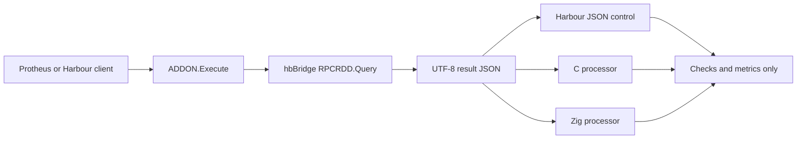

# Future native addon benchmarks and Protheus 12.1.2610 validation

[Português](benchmark-evolution.pt-BR.md) · [Methodology](benchmarking.md) · [WIP](../WIP.md)

Recorded on 2026-10-19 as future work. The C/Zig processors and PostgreSQL
acceptance described here are not implemented or accepted. V01/V02 retain
their recorded scope; D03 is next, followed by final M09 checks. These notes
do not expand the active package 001 scope or change its current priority.

## Two additional addon scenarios

Add one C processing scenario and one Zig processing scenario alongside the
existing Harbour addon. hbBridge owns SQL execution through the shared,
permission-checked `RPCRDD.Query` registry. It serializes the results as UTF-8
JSON and passes that JSON to the selected native processor. The processor
parses and processes the data, returning checks and metrics rather than
dataset rows. Protheus continues resolving business rules and inputs.

The branches represent alternatives: select one processor per scenario.
The existing Harbour hash-based result remains a historical baseline. A fair
processing-only comparison also needs a Harbour control consuming the same
JSON, since JSON parsing is additional work relative to the hash-based addon.

### Contract and correctness before timing

- Freeze identical SQL fixture values, pages/order/counts, UTF-8 input bytes,
  processing algorithm and expected output for Harbour, C and Zig. A
  deterministic reduction such as row count/checksum/sum is a candidate;
  define its exact numeric semantics before implementation.
- Pass JSON with an explicit byte length. Define input/output ownership,
  allocator and release rules across Harbour/C ABI/Zig, including failures.
  Keep state call-owned; worker reuse must not leak state between scenarios.
- Use matching tests for empty/null values, types, ordering, malformed JSON,
  text encoding and numeric preservation. Do not depend on JSON object member
  order. D03's integrity findings remain relevant to these new processors.
- Keep SQL credentials and lifecycle in hbBridge. Native processors receive
  data and explicit processing parameters, without opening another SQL
  connection or inferring company, branch, tenant or ERP table names.
- Record parser/library versions and integrate required artifacts through
  the managed toolchain. Choose static/library packaging and the C/Zig ABI
  during implementation; this note does not establish a delivered API.

### Timing scopes

| Scope | What it should measure |
| --- | --- |
| SQL/service | The shared query call, including lifecycle/lock costs present in that interval; do not label it isolated database execution. |
| Serialization | Producing the exact JSON supplied to each processor. |
| Native invocation | Crossing the bridge plus parsing/processing and result conversion. |
| Parsing / processing | Separately identified native stages where the chosen parser permits reliable measurement. |
| Complete addon RPC | HRB/loading, all query/data/processing stages, warmups, repetitions and returned metrics. |

Also measure a processing-only case using identical preloaded JSON. Keep it
separate from SQL/RPC timings. Use a common clock with recorded resolution;
repeat short processing work enough to exceed clock quantization. Preserve
warmups, failed samples, byte/row/page counts and identical algorithm checks.
Report end-to-end benefit independently of a language-stage speed ratio.
Preserve the existing SQL mutex and logical lease ownership.

## PostgreSQL and the Protheus 12.1.2610 reference environment

The supplied [docker-protheus-2610 repository](https://github.com/emebatista/docker-protheus-2610)
is a candidate test environment, reviewed on 2026-10-19. Its README reports
Protheus 12.1.2610, AppServer 26.3.0.0, DBAccess 26.1.0.0 and PostgreSQL 15.14,
with a restored WIN1252 database. These are upstream declarations, not hbBridge
runtime validation. See its [README](https://github.com/emebatista/docker-protheus-2610/blob/main/README.md).

The [Compose file](https://github.com/emebatista/docker-protheus-2610/blob/main/docker-compose.yml)
uses Linux amd64 images and mutable `latest` tags. Published ports include
1234, 4321, 5555 and 7890, which overlap the existing development setup;
prepare isolated mappings before a future launch. Pin the reviewed repository
commit and actual image digests when preparing that run. No container launch,
image/dependency adoption or environment replacement is part of this note.

The current [query implementation](../src/hb/services/hbbridge.query.hb)
accepts SQLite/MSSQL driver profiles. PostgreSQL needs an explicit connector,
profile and SQL dialect path before acceptance; changing an alias alone is
insufficient. Evaluate SQLMIX/SDDPG or a PostgreSQL ODBC route and its managed
dependencies. Existing MSSQL fixture conversions, quoting and COUNT_BIG must
be adapted while retaining equivalent values and expected results.

### Future acceptance sequence

1. Record actual server/database/client encodings, versions, SDK/includes/RPO,
   compiler, Harbour/C/Zig dependencies, database identity and network paths.
   Verify the WIN1252 declaration against the running database and define the
   UTF-8 transport conversion/policy explicitly.
2. Implement/validate the PostgreSQL connector and dialect with a private,
   explicitly selected profile. Protheus owns ERP context and business SQL.
3. Compile the TLPP clients/tests with the target environment's supported SDK;
   exercise Health/Echo/addon, Query/pages/totals/types/nulls/text/numbers,
   failures/recovery, concurrency and resource release before measuring speed.
4. Repeat the client and Harbour/C/Zig addon workloads with recorded build/image
   identities, budgets, warmups, order and timing scopes. Keep backend, OS and
   Protheus version changes identifiable: a combined MSSQL-to-PostgreSQL and
   2510-to-2610 change does not isolate the effect of either variable.
5. Accept Windows-host/container and native Linux hbBridge routes separately;
   container availability alone does not establish Linux product acceptance.

The future environment must not inherit MSSQL or 12.1.2510 acceptance by name.
These are reference tasks; scheduling follows the active WIP.
