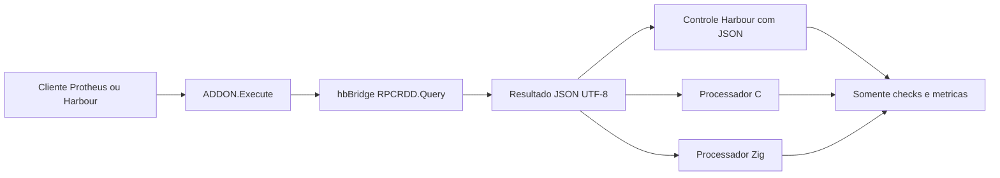

# Benchmarks futuros de addon nativo e validação Protheus 12.1.2610

[English](benchmark-evolution.md) · [Metodologia](benchmarking.pt-BR.md) · [WIP](../WIP.pt-BR.md)

Registrado em 2026-10-19 como trabalho futuro. Os processadores C/Zig e o
aceite PostgreSQL descritos aqui não estão implementados nem homologados.
V01/V02 preservam seu escopo registrado; D03 é a próxima, seguida dos checks
finais M09. Estas notas não ampliam o escopo ativo do pacote 001 nem alteram
sua prioridade.

## Dois cenários adicionais no addon

Adicionar um cenário de processamento em C e outro em Zig junto ao addon
Harbour existente. hbBridge mantém a execução SQL pelo registro compartilhado
`RPCRDD.Query`, sujeito às permissões. Serializa os resultados em JSON UTF-8
e fornece esse JSON ao processador nativo escolhido. O processador faz parsing
e processamento, devolvendo checks e métricas em vez de linhas do dataset.
Protheus continua resolvendo as regras de negócio e entradas.

As ramificações são alternativas: selecionar um processador por cenário.
O resultado Harbour atual baseado em hashes permanece como baseline histórica.
Para comparar somente processamento, também será necessário um controle
Harbour consumindo o mesmo JSON: o parsing é trabalho adicional em relação
ao addon baseado em hashes.

### Contrato e correção antes dos tempos

- Fixar valores da fixture SQL, páginas/ordem/totais, bytes JSON UTF-8,
  algoritmo e resultado esperado idênticos para Harbour, C e Zig. Uma redução
  determinística como contagem/checksum/soma é candidata; definir sua
  semântica numérica exata antes de implementar.
- Passar JSON com tamanho explícito em bytes. Definir posse de entrada/saída,
  alocador e liberação entre Harbour/ABI C/Zig, inclusive nas falhas. Manter
  estado por chamada, sem vazamento por reaproveitamento de workers.
- Usar testes equivalentes para vazio/null, tipos, ordem, JSON inválido,
  codificação e preservação numérica. Não depender da ordem das propriedades
  de objetos JSON. As constatações de integridade D03 continuam relevantes.
- Manter credenciais e ciclo SQL no hbBridge. Processadores nativos recebem
  dados e parâmetros explícitos, sem abrir outra conexão SQL nem inferir
  empresa, filial, tenant ou nomes físicos das tabelas ERP.
- Registrar versões dos parsers/bibliotecas e integrar os artefatos ao
  toolchain gerenciado. Escolher empacotamento estático/biblioteca e ABI C/Zig
  na implementação; esta nota não estabelece uma API entregue.

### Escopos de tempo

| Escopo | O que deve medir |
| --- | --- |
| SQL/serviço | A chamada Query compartilhada, incluindo custos de ciclo/lock presentes nesse intervalo; não descrever como execução isolada no banco. |
| Serialização | Produção do JSON exato fornecido a cada processador. |
| Invocação nativa | Passagem pela ponte, parsing/processamento e conversão do resultado. |
| Parsing / processamento | Etapas nativas identificadas separadamente quando o parser permitir medição confiável. |
| RPC completa do addon | HRB/carga, consultas, dados, processamento, aquecimentos, repetições e retorno das métricas. |

Medir também processamento isolado com o mesmo JSON previamente carregado,
separado de SQL/RPC. Usar relógio comum com resolução registrada; repetir
operações curtas em quantidade suficiente para superar a quantização.
Preservar aquecimentos,
amostras com falha, contagens de bytes/linhas/páginas e checks do mesmo algoritmo.
Informar benefício total separadamente da razão de velocidade de uma etapa
da linguagem. Preservar mutex SQL e posse dos leases lógicos existentes.

## PostgreSQL e ambiente de referência Protheus 12.1.2610

O [repositório docker-protheus-2610](https://github.com/emebatista/docker-protheus-2610)
indicado é candidato a ambiente de testes, consultado em 2026-10-19. Seu README
informa Protheus 12.1.2610, AppServer 26.3.0.0, DBAccess 26.1.0.0 e PostgreSQL
15.14, com base restaurada WIN1252. São declarações do projeto externo, sem
aceite runtime hbBridge. Veja seu
[README](https://github.com/emebatista/docker-protheus-2610/blob/main/README.md).

O [Compose](https://github.com/emebatista/docker-protheus-2610/blob/main/docker-compose.yml)
usa imagens Linux amd64 e tags mutáveis `latest`. Portas publicadas incluem
1234, 4321, 5555 e 7890, sobrepostas ao ambiente de desenvolvimento existente;
preparar mapeamentos isolados antes de uma futura inicialização. Fixar commit
do repositório e digests efetivos das imagens ao preparar a execução. Esta nota
não inclui inicialização de containers, adoção de imagens/dependências nem
substituição do ambiente.

A [implementação Query atual](../src/hb/services/hbbridge.query.hb) aceita
perfis SQLite/MSSQL. PostgreSQL exige caminho explícito de conector, perfil e
dialeto SQL antes do aceite; mudar apenas um alias não resolve. Avaliar
SQLMIX/SDDPG ou ODBC PostgreSQL e suas dependências gerenciadas. Adaptar
conversões da fixture MSSQL, quoting e COUNT_BIG mantendo valores e resultados
esperados equivalentes.

### Sequência futura de homologação

1. Registrar encodings reais de servidor/banco/cliente, versões, SDK/includes/
   RPO, compilador, dependências Harbour/C/Zig, identidade do banco e caminhos
   de rede. Conferir WIN1252 no banco executado e definir conversão/política
   explícita do transporte UTF-8.
2. Implementar/validar conector e dialeto PostgreSQL com perfil privado e
   selecionado explicitamente. Protheus mantém contexto ERP e SQL de negócio.
3. Compilar clientes/testes TLPP com o SDK suportado pelo alvo; exercitar
   Health/Echo/addon, Query/páginas/totais/tipos/null/texto/números,
   falhas/recuperação, concorrência e liberação antes de medir desempenho.
4. Repetir cargas cliente e addons Harbour/C/Zig registrando builds/imagens,
   prazos, aquecimentos, ordem e escopos. Identificar mudanças de banco, SO e
   versão: trocar simultaneamente MSSQL por PostgreSQL e 2510 por 2610 não
   isola o efeito de cada variável.
5. Homologar separadamente hbBridge no host Windows/com containers e nativo
   Linux; disponibilidade do container não homologa o produto no Linux.

O ambiente futuro não herda aceites MSSQL ou 12.1.2510 pelo nome.
São tarefas de referência; a execução segue o WIP ativo.
